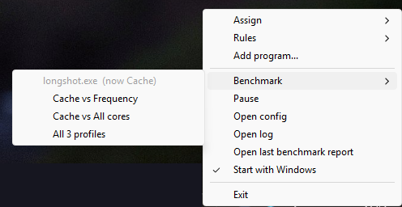
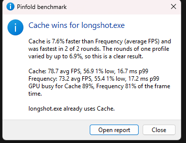

# Pinfold

Pinfold is a small tray tool for Windows. It keeps programs on the CPU cores
that you select, each time they start. Example: a game on the V-Cache CCD of a
dual-CCD Ryzen X3D.

A pinfold is a pen for stray animals. This one keeps stray processes.



The specification is in [docs/SPEC.md](docs/SPEC.md). It uses the old name
"CorePin".

## Build

You need the Rust toolchain (MSVC target) and the Visual Studio C++ Build
Tools.

```
cargo build --release
```

The result is `target\release\Pinfold.exe`. It is one file and needs no runtime.

## Install

From a release:

1. Download the zip from [Releases](https://github.com/megglos/pinfold/releases).
2. Extract `Pinfold.exe` to `%LocalAppData%\Programs\Pinfold`.
3. Start `Pinfold.exe`.
4. In the tray menu, select "Start with Windows".

From the source:

```
powershell -ExecutionPolicy Bypass -File scripts\install.ps1 -Autostart
```

The script builds Pinfold, copies it to `%LocalAppData%\Programs\Pinfold` and
starts it again. `-Autostart` also sets "Start with Windows". Run the script
again after each change.

`assets\make-icon.ps1` makes the icons.

## Uninstall

```
powershell -ExecutionPolicy Bypass -File scripts\uninstall.ps1
```

The script:

1. Removes "Start with Windows" (the logon task and the Run entry). If there
   is a logon task, you get one UAC prompt.
2. Stops Pinfold.
3. Deletes `%LocalAppData%\Programs\Pinfold`.

The script keeps `%AppData%\Pinfold` (config, log, benchmark reports). To
delete it also, add `-RemoveData`.

To uninstall without the script:

1. In the tray menu, clear "Start with Windows".
2. In the tray menu, select "Exit".
3. Delete `%LocalAppData%\Programs\Pinfold`.
4. Optional: delete `%AppData%\Pinfold`.

Programs that Pinfold pinned keep their cores until they start again.
Pinfold does not change Windows settings or the registry, except the
"Start with Windows" entries.

## Use

```
Pinfold.exe                          background instance with tray icon
Pinfold.exe add <exe|lnk> [--profile <name>] [--mode affinity|cpusets|both] [--full-path]
Pinfold.exe remove <exe>
Pinfold.exe list
Pinfold.exe topology
Pinfold.exe run                      engine in a console, no tray
Pinfold.exe autostart [on|off]       show or change "Start with Windows"
Pinfold.exe quit                     stop the background instance
Pinfold.exe benchmark <exe> [--profiles A,B] [--seconds 60] [--rounds 2] [--apply]
```

To add a rule, drop an `.exe` or a `.lnk` shortcut on `Pinfold.exe` and select
a profile. Pinfold cannot read `.url` links (Steam, Store). For these, start
the program and assign it from the tray menu.

With the tray menu, you can:

- assign a running program to a profile
- change or remove rules
- benchmark profiles for a running game
- add a program with a file picker
- pause, open the config or the log, set "Start with Windows"
- show the version and the GitHub page (About Pinfold).

The tooltip of the tray icon shows the version.

The config and the log are in `%AppData%\Pinfold` (`config.json`,
`pinfold.log`). When the config file changes, Pinfold reads it again. At the
first start, Pinfold makes profiles from the CPU topology: "Cache" and
"Frequency" if there are two L3 domains of different size, and "All cores".

### Start with Windows and elevation

If a game runs elevated, Pinfold must also run elevated. If not, the rule
shows "denied". Thus "Start with Windows" makes a Task Scheduler logon task
that starts Pinfold with the highest rights of your account. You get one UAC
prompt when Pinfold makes or removes the task. There is no prompt at logon.

To use the `HKCU\...\Run` entry instead, set `"elevatedAutostart": false` in
the config. Pinfold then runs without elevation.

## Benchmark: which profile is faster for a game?

1. Start the game.
2. In the tray menu, select **Benchmark** and a comparison below the game.
3. Go to the game. A notification also tells you to do this.

The benchmark starts when the game is the window in front. Pinfold moves the
game from profile to profile. It records the frame times of each profile with
[PresentMon](https://github.com/GameTechDev/PresentMon/releases). It compares
average FPS, 1 % and 0.1 % lows, and frame-time percentiles (p50, p95, p99,
p99.9).

The benchmark has no window:

- Sounds tell you about the start, each switch, problems and the end.
- The tray icon becomes a ring that fills. The tooltip shows the step.
- If the game is not in front (Alt+Tab), Pinfold discards that capture and
  does it again.
- To stop early, select "Stop benchmark" in the tray menu.

Pinfold always puts the rule back as it was.


At the end, a notification and a dialog show the result:

- **Clear winner**: one profile was fastest in all rounds. Its lead is larger
  than the spread between rounds and at least 2 %. The dialog can make it the
  rule.
- **No clear winner**: the dialog gives the reason. The rounds do not agree,
  or the difference is in the noise.
- **GPU-bound**: the GPU was busy for 90 % or more of each frame in all
  profiles. The CPU waits for the GPU, so the profile has no effect. Decrease
  the resolution or the render scale and do the benchmark again.



To see the full report, select "Open report" in the dialog or "Open last
benchmark report" in the tray menu.

In a console, `Pinfold.exe benchmark game.exe` does the same and prints the
report. The window title shows the progress. Ctrl+C stops the benchmark.
Pinfold asks if a clear winner must become the rule. `--apply` does this
without a question.

```
metric               Cache  Frequency  vs Cache
-----------------------------------------------
avg FPS             143.20     131.75     -8.0%
1% low FPS           96.40      81.10    -15.9%
frame time p99 ms    10.12      12.05    +19.1%
```

(example numbers)

Setup: get the PresentMon console application. Put the `.exe` next to
`Pinfold.exe`, or set `"presentMon": "C:\\path\\PresentMon.exe"` in the
config, or use `--presentmon <path>`. PresentMon needs administrator rights.
An elevated Pinfold (see above) starts it without a prompt.

Options:

| Option | Default | Function |
|---|---|---|
| `--profiles` | see menu | profiles to compare, for example `"Cache,Frequency,All cores"` |
| `--seconds` | 60 | length of one capture |
| `--rounds` | 2 | number of rounds; each second round uses the reverse order |
| `--settle` | 5 | seconds to wait after each switch |
| `--countdown` | 3 | seconds to wait after the game comes to the front |
| `--ignore-focus` | off | capture also when the program is not in front (for programs without a window) |

Pinfold keeps the captures and the report in `%AppData%\Pinfold\benchmarks`.

For a good result:

- Keep the scene the same during the full run. Stand still, or repeat the
  same path. Each change on the screen also changes the numbers.
- Make the game CPU-bound: decrease the resolution or the settings. If the
  GPU is the limit, all profiles give the same result.
- A difference of less than 2-3 % is noise. Use more rounds to be sure.
- A game sets the size of its thread pools when it starts. To include this
  effect, compare two sessions: record each with PresentMon and run
  `scripts\compare-frametimes.ps1 a.csv b.csv`.

## Tests

```
cargo test
```

CI runs all tests on each push (`.github/workflows/ci.yml`). It also runs
`cargo fmt --check` and `cargo clippy -D warnings`.

- **Unit tests** (`src/**`): CPU ranges, default profiles, config, rule
  match, back-off.
- **Engine tests** (`src/engine/tests.rs`): the engine uses the operating
  system only through the `System` trait. These tests use a fake system with
  scripted processes: apply, drift, back-off, denied, process exit, PID
  reuse, config reload, pause. They touch no real process.
- **Integration tests** (`tests/`): these run the real `Pinfold.exe` with
  `PINFOLD_DIR` set to a private directory. `cli.rs` tests the command line.
  `benchmark.rs` runs the benchmark with a fake PresentMon. `pinning.rs`
  starts the engine and real target processes. It reads their affinity mask
  and CPU Sets through the Windows API.

The tests do not use `%AppData%\Pinfold`. They do not affect an installed
Pinfold that runs. There are no automated tests for the tray menu, the
dialogs and the logon task (it needs a UAC prompt).

## Release

1. Set the version in `Cargo.toml`.
2. Write the section of the version in `CHANGELOG.md`.
3. Commit, then push a tag: `git tag v<version>`, `git push origin v<version>`.

The workflow `.github/workflows/release.yml` checks that the tag and the
version agree, runs all checks and tests, and builds the files. It
publishes a GitHub release with the zip, the executable and `SHA256SUMS.txt`.
The release notes are the changelog section, the commits since the last
tag and the checksums (`scripts\release-notes.ps1`). A version with a suffix
(`1.0.0-beta1`) becomes a pre-release.

## Status

Pinfold has all the functions of the spec: topology and default profiles;
rules by file name or full path; apply by affinity mask, CPU Sets or both;
drift detection with back-off; denied processes; config reload; log and
startup diagnostics; tray menu; add programs from the process list, by drag
and drop, file picker or command line, also from `.lnk` shortcuts; elevated
autostart. The benchmark is an addition to the spec.

Resource use (spec section 8), measured for 10 minutes idle with 5 rules and
2 matched processes on a Ryzen 9 9950X3D (`scripts\measure.ps1`):

| Item | Target | Measured |
|---|---|---|
| Private memory | less than 5 MB | 2.6 MB |
| CPU | less than 0.1 % of one core | 0.018 % |
| Executable size | less than 2 MB | 0.5 MB |
| Disk writes when nothing occurs | none | none |
| Threads | 1 worker and the tray loop | 3: the engine runs on the tray thread, Windows owns the other two |

Known limits:

- Pinfold can miss a program that starts in the same poll interval in which
  an unmatched process with the same PID stopped. It finds the program after
  the next restart. A fix needs process-start events (ETW, optional in the
  spec), or a check of all processes at each poll. The resource budget does
  not allow the second. Matched and denied processes are not affected.
- There are no automated tests for the tray menu and the dialogs.
- Not done: the interference test (spec M0) and the 30-minute game session
  (A8). Both need a person who plays real games.
